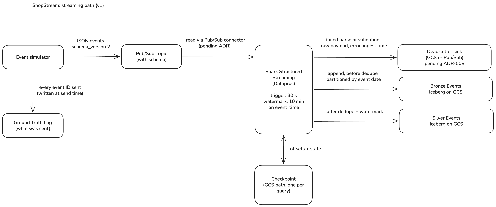

# ShopStream Platform Design Doc

- Status: draft v0.1
- Author: omkarpere
- Last updated: 2026-10-23

## 1. Problem and goals
ShopStream is a fictional online retailer. Today its teams work from different, delayed views of the business. Marketing cannot see the shopper funnel live. Finance cannot prove that reported revenue matches orders. Customer success has no single view of a customer, and security has no guarantee that personal data is protected. This project builds one platform on Google Cloud that serves all four needs with data that is fresh, correct and safe.

This is a portfolio project built on simulated data to practice production data engineering patterns. It is not a production system.

| ID | Stakeholder | Goal | How we will measure it |
|---|---|---|---|
| G1 | Marketing | Live funnel data | From the simulator publishing an event to it being saved in Silver: under 60 seconds at p95. The start clock is the Pub/Sub publish timestamp, not `event_time`, which is client time. The end clock is the Silver commit time. The Silver to BigQuery delay is measured separately (see Section 8) |
| G2a | Marketing, Finance | No duplicate events | Zero duplicate event IDs in Silver after a one-hour replay |
| G2b | Marketing, Finance | Late events counted | Events up to 10 minutes late land in the correct windows |
| G2c | Marketing, Finance | Very late events kept | Events later than the watermark go to a late-data table, never dropped silently |
| G3 | Customer success | Fresh operational data | Postgres inserts, updates and deletes visible in BigQuery within 2 minutes at p95, measured with a timestamp written at the source |
| G4 | Finance | Trusted revenue and customer 360 | Gold tables reconcile to source orders to the cent; daily marts ready by 06:00 IST |
| G5 | Security and compliance | PII protected by default | Analyst role sees masked email and phone; steward role sees raw values |
| G5b | Security and compliance | PII access is auditable | Data access logs show who read a PII column; one saved example query is the evidence |
| G6 | Engineering leadership | Safe reprocessing | A 30-day backfill reproduces the original row counts and checksums |
| G7 | Engineering leadership | Failures are noticed fast | Alerts within 5 minutes for pipeline failure, Pub/Sub backlog and stale data |

Engineering goals: all infrastructure in Terraform, every change through a pull request with automated checks, every pipeline idempotent and restartable, and measured before-and-after numbers for performance and cost.

### Assumptions

- All data is simulated. There are no real customers.
- Everything runs in a single GCP region.
- The environment is only switched on during work sessions, so freshness and alert goals (G1, G3, G7) only apply while it is running.
- An average event is about 1 KB of JSON. This is a guess and will be replaced by the real average measured from the simulator.
- Free trial credit is the budget limit, and budget alerts warn but do not stop spending.

## 2. Non-goals (what we deliberately won't build)
- **Multi-region deployment and disaster recovery.** It multiplies cost and failure modes without teaching anything the single-region design does not already cover.
- **Real customers or real personal data.** All data is simulated, which removes legal exposure while still letting us practice PII classification, masking and audit.
- **Machine learning features or a feature store.** The goal is the data platform, not models. Adding ML would compete for the same limited time.
- **Self-managed CDC with Debezium.** Datastream gives the same outcome with far less operational work. We document the trade-off in an ADR instead of building both.
- **24/7 on-call and formal SLAs.** There is no real business or pager. We write alert runbooks and run failure drills to practice the thinking.
- **Sustained peak throughput.** The simulator can reach 5,000 events per second, but we run it at that rate only briefly for benchmarks, because holding it would burn the trial credit without new learning.
- **An always-on environment.** Dev and prod are only switched on during work and demo sessions, because idle Composer, Dataproc, Cloud SQL and Datastream would burn the trial credit. Freshness and alert goals only apply while the environment is running.

## 3. Stakeholders and requirements

### 3.1 How each goal is measured

G1 to G7 match F1 to F7 in the project guide. Every goal needs a start point, an end point and a place where the result is written down.

| Goal | Start point | End point | Where recorded |
|---|---|---|---|
| G1: event saved in Silver within 60 s at p95 | Time Pub/Sub receives the event (set by Pub/Sub's server) | Time the Spark job saves the event in Silver | `docs/measurements/latency.md` |
| G2a: no duplicates | Silver row count before the replay | Silver row count after the replay (must be equal) | `docs/measurements/dedupe.md` |
| G2b: 8 min late events still included | Simulator sends an event with `event_time` 8 min in the past | Event found in the correct 1-minute window in Silver | `docs/measurements/late-events.md` |
| G2c: 15 min late events go to the late-data table | Simulator sends an event with `event_time` 15 min in the past | Event found in the late-data table and not in Silver windows | `docs/measurements/late-events.md` |
| G3: Postgres insert, update and delete visible in BigQuery within 2 min at p95 | Timestamp written in the Postgres row when the change is made (source clock) | Time the change first shows up in a BigQuery query (query time) | `docs/measurements/cdc-latency.md` |
| G4a: revenue matches source orders to the cent | Total revenue from the source orders table for one day | Total from the Gold daily revenue table for the same day (difference must be 0.00) | `docs/measurements/reconciliation.md` |
| G4b: daily marts ready by 06:00 IST (00:30 UTC) | Daily job starts (Airflow run start, UTC) | Gold tables finish building (must be before 00:30 UTC) | `docs/measurements/mart-readiness.md` |
| G5a: PII masked for analysts, raw for stewards | Same query run as the analyst role, then as the steward role | Analyst sees masked email and phone, steward sees raw values (screenshot of both) | `docs/measurements/pii-masking.md` |
| G5b: access to PII columns is auditable | A query reads a PII column as a named role | The access log shows who read it and when | `docs/measurements/pii-audit.md` |
| G6: 30-day backfill reproduces the original | Row count and checksum of the 30-day range from the original run | Row count and checksum after the backfill (must be identical) | `docs/measurements/backfill.md` |
| G7a: pipeline failure alert within 5 min | Time the failure is caused (my clock, noted in the log) | Time the alert email arrives (email timestamp) | `docs/measurements/alert-latency.md` |
| G7b: Pub/Sub backlog alert within 5 min | Time the streaming job is paused on purpose | Time the alert email arrives | `docs/measurements/alert-latency.md` |
| G7c: stale data alert within 5 min | Time the simulator is stopped on purpose | Time the alert email arrives | `docs/measurements/alert-latency.md` |

### 3.2 Latency budget

G1 allows 60 seconds from Pub/Sub receiving an event to that event being saved in Silver. This table splits the 60 seconds into stages. Stage 3 is a design choice (the trigger interval), and the other stages are placeholders until measured in Week 3.

| Stage | What happens | Budget |
|---|---|---|
| 1 | Pub/Sub makes the event available to Spark (the G1 clock starts when Pub/Sub receives it) | TBD (measure in Week 3) |
| 2 | Spark picks the event up from Pub/Sub | TBD (measure in Week 3) |
| 3 | Event waits for the next micro-batch to start | Up to 30 s (trigger interval) |
| 4 | Spark processes the batch (parse, dedupe) | TBD (measure in Week 3) |
| 5 | Spark saves the batch to Silver (Iceberg commit) | TBD (measure in Week 3) |

Stage 3 can use half of the 60 seconds, so stages 1, 2, 4 and 5 must fit in the remaining 30 seconds. If the measured total exceeds 60 s at p95, the first lever is a shorter trigger interval, at the cost of more small files.

### 3.3 Capacity estimate

These numbers are back-of-envelope estimates based on the 1 KB per event assumption in Section 1. They will be replaced by the simulator's measured average event size.

| Scenario | Events per second | Events per day | Data per second | Data per day |
|---|---|---|---|---|
| Peak (benchmark only, run for minutes) | 5,000 | 432 million | about 5 MB | about 432 GB |
| Development rate | 100 | 8.64 million | about 0.1 MB | about 8.6 GB |

The platform only runs during work sessions, so real daily volume is far below these figures. Cost of one peak benchmark run: TBD (INR, from the billing report in Week 3).

If data were 100 times larger, the first things to revisit would be Spark cluster size, the trigger interval (to avoid small files) and BigQuery partitioning.

## 4. Architecture overview

### 4.1 Streaming path (diagram pass 1)

This section covers the streaming path only. CDC, the FX batch job, BigQuery, dbt and Composer are added in diagram pass 2.

Editable source: `diagrams/streaming-path.excalidraw`.

**One event, left to right**

1. The event simulator sends a JSON event (schema_version 2) to a Pub/Sub topic. It also writes the event ID to a ground-truth log at send time. The log is what lets us prove "no loss, no duplicates" after a restart.
2. One Spark Structured Streaming job on Dataproc reads from Pub/Sub. The read mechanism (Pub/Sub connector or a fallback) is pending an ADR.
3. The job parses and validates each row against an explicit schema. Rows that fail go to the dead-letter sink with the raw payload, the error reason and the ingestion time. The sink type (GCS path or Pub/Sub topic) is pending ADR-008. The pipeline keeps running.
4. Valid rows are appended untouched to Bronze (Iceberg on GCS, partitioned by event date). Bronze is written before dedupe, so it keeps duplicates and is a faithful record of what arrived.
5. The job then deduplicates on `event_id` inside a 10-minute watermark on `event_time` and writes Silver (Iceberg on GCS).
6. Each query writes offsets and state to its own checkpoint path on GCS, and reads them back on restart. Checkpoint locations are never shared between queries.

**Accounting rule:** Bronze rows plus dead-letter rows should equal the events in the ground-truth log, duplicates included. This is the check for the restart test.

**Latency link:** the 30 s trigger in the diagram is the stage-3 allowance in the latency budget (Section 3.2).

**Not decided yet:** where events later than the watermark go is an open question (Section 8).

### 4.2 Components and failure behaviour

| Component | Role | Where its state lives | If it fails | Detection |
|---|---|---|---|---|
| Event simulator | Generates events with duplicates, late and malformed rows | Stateless; writes the ground-truth log | Events stop arriving. Nothing downstream is corrupted. | Freshness alert on Silver (TBD threshold, see Section 8) |
| Ground-truth log | Independent record of every event ID sent | Durable file or table (location TBD) | Cannot prove no-loss for that run. Pipeline is unaffected. | Manual check before each restart test |
| Pub/Sub topic | Buffers events between producer and Spark | Managed by Google | Managed service; messages are retained until acknowledged | Oldest unacked message age over 5 minutes |
| Spark Structured Streaming job | Parse, validate, write Bronze, dedupe, write Silver | Checkpoint on GCS (job holds no durable state) | Unacknowledged messages stay in Pub/Sub. A restart resumes from the checkpoint. A half-finished batch may be replayed, so sinks must be idempotent. | Job not running, or processing lag growing for 10 minutes |
| Dead-letter sink | Quarantines rows that fail parse or validation | GCS path or Pub/Sub topic (pending ADR-008) | Bad rows could be lost, so this sink must be at least as reliable as Bronze | Dead-letter rate over threshold (TBD) |
| Bronze (Iceberg on GCS) | Faithful raw copy of valid events, before dedupe | GCS | Raw valid events could be lost. Replay from Pub/Sub works only if retention of acknowledged messages is enabled (pending ADR). The ground-truth log holds IDs only, so it detects loss but cannot restore data. GCS object versioning is a mitigation (TBD) | Volume vs 7-day baseline (guide Section 15) |
| Silver (Iceberg on GCS) | Deduplicated, typed events | GCS | Rebuild from Bronze | Freshness: max event_time older than 10 minutes |
| Checkpoint (GCS) | Offsets, state and a log of finished batches | GCS, one path per query, never shared | If lost, the job cannot resume safely and must be rebuilt from Bronze | Bucket versioning and access alerts (TBD, Week 3) |

Failure-behaviour claims for Pub/Sub acknowledgement and retention depend on the connector chosen in the pending ADR. Verify against the official docs in Week 3.

### 4.3 Data flows (one row per arrow in the diagram)

| # | From | To | What flows | Guarantee or rule |
|---|---|---|---|---|
| 1 | Event simulator | Pub/Sub topic | JSON events, schema_version 2 | Checked against the Pub/Sub schema. Delivery can repeat, and the simulator also injects 1 to 2 percent duplicates on purpose |
| 2 | Event simulator | Ground-truth log | Every event ID sent | Written at send time by the simulator, independent of the pipeline |
| 3 | Pub/Sub topic | Spark job | Messages read through the connector | Acknowledgement and offset behaviour depends on the connector (pending ADR, verify in Week 3) |
| 4 | Spark job | Dead-letter sink | Rows that fail parse or validation | Raw payload, error reason and ingestion time are kept. The pipeline keeps running |
| 5 | Spark job | Bronze | Valid events, append only | Written before dedupe, partitioned by event date. Duplicates are kept |
| 6 | Spark job | Silver | Deduplicated events | Dedupe on event_id within the 10-minute watermark on event_time. Idempotent write: MERGE on event_id in foreachBatch (guide Section 9.2) |
| 7 | Spark job and checkpoint (both ways) | | Offsets, state, commit log | One checkpoint path per query, never shared. Read on restart, written after each batch |

**Consistency rule:** every row above matches one arrow label in `streaming-path.png`. If the diagram changes, update this table in the same pull request.

### 4.4 Environments

| Item | Decision |
|---|---|
| Environments | Two separate GCP projects: `shopstream-dev` and `shopstream-prod` (ADR-007: blast-radius isolation, separate IAM and budgets) |
| Region | `asia-south1` (Mumbai), **accepted** after checking the official docs (see 4.5). Keep GCS, Dataproc, BigQuery, Datastream and Cloud SQL in this region, and restrict Pub/Sub message storage to it with a message storage policy, to avoid cross-region cost and latency |
| Dev | Daily development, small volumes, torn down after each session |
| Prod | Changed only by CD from `main` after manual approval. For a portfolio project it runs only during demo and test windows |
| Labels | Every resource carries `env`, `owner`, `project` |
| Budgets | `budget-dev` and `budget-prod`, alerts at 50, 80 and 100 percent |
| Secrets | Secret Manager only. Never in the repo |
| Local setup | No default gcloud project is set, so each command names its project explicitly |

### 4.5 Region verification (F-8)

Checked against official Google Cloud docs on 25 Oct 2026. Decision: `asia-south1` (Mumbai).

| Service | In asia-south1? | Source (docs.cloud.google.com unless noted) | Note |
|---|---|---|---|
| Datastream | Yes | datastream/docs/ip-allowlists-and-regions | Listed in the regions table |
| Dataproc clusters (now called Managed Service for Apache Spark) | Yes | dataproc/docs/resources/faq, dataproc/docs/concepts/cluster-region | FAQ says all regions and zones |
| Dataproc Serverless batches | Likely, not directly confirmed | Billing SKU lists only | Prove with a tiny batch job in Week 4 |
| Cloud Composer | Composer 3: yes. Composer 2: not verified | cloud.google.com/composer/pricing | Choose version in ADR-005 |
| Pub/Sub | Yes, through a message storage policy | pubsub/docs/resource-location-restriction | Topics are global, so restrict where messages are stored |
| BigQuery | Yes | bigquery/docs/locations | Datasets can be created in asia-south1 |
| Cloud SQL (Postgres) | Yes | sql/docs/postgres/region-availability-overview | Location is chosen at instance creation. N4 machines not listed for Mumbai |

Open items: Composer 2 vs 3 (ADR-005), Dataproc Serverless proof (Week 4), exact Terraform syntax for the Pub/Sub storage policy (Week 3).

## 5. Data sources and data design

### 5.1 Clickstream events (JSON via Pub/Sub)

| Field | Type | Notes |
|---|---|---|
| event_id | string (UUID) | Dedup key |
| event_type | string | page_view, product_view, add_to_cart, checkout_start, purchase |
| event_time | timestamp | Client time, used for event-time windows |
| user_id | string | Nullable for anonymous sessions |
| session_id | string | |
| product_id | string | |
| price | decimal | |
| device, country | string | |
| schema_version | int | Used to demonstrate schema evolution (v3 adds coupon_code) |

The simulator injects problems on purpose: 1 to 2 percent duplicates, 2 to 5 percent late events (up to 10 minutes), 0.5 percent malformed events, and occasional bursts. It also writes a ground-truth log of what it sent, so counts can be proven after a restart or replay.

### 5.2 Postgres OLTP (via Datastream)

Tables: customers, addresses, products, orders, order_items, payments. The generator simulates inserts, updates (address change, order status: placed, paid, shipped, delivered, refunded) and occasional deletes (GDPR-style customer deletion).

### 5.3 FX rates API (daily batch)

Daily rates from a free public exchange-rate API, landed as Parquet partitioned by date. Finance uses them to convert revenue to USD. Re-running a date overwrites only that partition.

### 5.4 Gold model (star schema)

| Table | Grain | Key points |
|---|---|---|
| fct_orders | One row per order item | Partitioned by order date, clustered by customer_id |
| fct_events_funnel_hourly | Hour, product, event_type | Incremental from Silver |
| fct_daily_revenue | Day, country | Net of refunds, INR and USD |
| dim_customer | One row per customer version | SCD Type 2: valid_from, valid_to, is_current |
| dim_product | One row per product | Type 1 (overwrite) |
| dim_date | One row per date | Generated |
| mart_customer_360 | One row per customer | LTV, order count, last order, recency segment |

### 5.5 PII classification

| Column | Class | Treatment |
|---|---|---|
| email, phone, full_name | High | Policy tag, masked for general readers |
| address | High | Policy tag; Gold exposes only city and state to analysts |
| user_id, customer_id | Medium | Pseudonymous, joins allowed |
| price, quantity | Low | Open |
## 6. Key design decisions (link ADRs)

Every non-obvious choice gets an ADR in `docs/adr/` (Context, Options considered, Decision, Consequences). Update the status here when each one lands (issue #13).

| ADR | Decision | Status | Notes |
|---|---|---|---|
| ADR-001 | Spark on Dataproc (now Managed Service for Apache Spark) for streaming and batch | Accepted | docs/adr/001-spark-on-managed-spark.md |
| ADR-002 | Iceberg as the lake table format | Not written | Compare with Delta and plain Parquet. |
| ADR-003 | Datastream for CDC | Not written | Less control than Debezium, much less operations work. |
| ADR-004 | dbt for warehouse transformation | Not written | Tests, docs and lineage built in. |
| ADR-005 | Composer for orchestration | Not written | Verify Composer 2 vs 3 and compare INR cost (open question 6). |
| ADR-006 | Medallion layout | Not written | Clear contracts between layers, easy reprocessing. |
| ADR-007 | Dev and prod as separate GCP projects | Accepted | docs/adr/007-separate-dev-prod-projects.md |
| ADR-008 | Dead-letter handling strategy | Not written | Never drop bad data silently; quarantine and alert. |
## 7. Risks and mitigations

| Risk | Likelihood | Impact | Mitigation |
|---|---|---|---|
| Cloud cost overrun | Medium | High | Budget alerts, teardown script, small volumes, environment only on during sessions |
| Pub/Sub to Spark connector difficulties | Medium | Medium | Time-box to 2 days; fall back to a Kafka-compatible bridge or Pub/Sub to GCS micro-batch; record in an ADR (open question 8) |
| Scope too big | High | Medium | Build the core path first (streaming, dbt, Airflow), then CDC, governance, extras |
| Iceberg and BigQuery integration friction | Medium | Medium | Use BigLake tables or export Silver to native BigQuery tables; document the choice (open question 1) |
| Time shortage | Medium | Medium | Cut in this order: Dataplex extras, Looker polish, Debezium. Never cut tests, CI/CD, runbook or drills |
| Composer 2 not creatable or Composer 3 costs more | Medium | Medium | Check availability and INR cost before ADR-005; fall back to Cloud Scheduler plus Cloud Run jobs (open question 6) |
| Dataproc Serverless not available in asia-south1 | Low | Medium | Prove with one real job in Week 4; fall back to a small Dataproc cluster in the same region (open question 7) |
| Google provider 8.0 breaking changes | Medium | Low | Pinned to ~> 7.0 with committed lock files; upgrade later in its own PR after reading the upgrade guide |
## 8. Open questions

Each question has an owner and a date to resolve it.

1. **How will BigQuery read the Iceberg Silver tables, and how much delay does that add?** This decides whether the dashboard is as fresh as G1. Owner: me. Resolve by: end of Week 3.
2. **Does the Datastream staleness setting for BigQuery allow G3 (2 minutes)?** I must check the docs before promising it. Owner: me. Resolve by: start of Week 4, before configuring CDC.
3. **How do we route events older than the watermark to a late-data table (G2c)?** Spark discards them by default, so we need our own logic. Owner: me. Resolve by: end of Week 3.
4. **How do we handle 06:00 IST for G4 when Airflow defaults to UTC?** 06:00 IST is 00:30 UTC. Owner: me. Resolve by: end of Week 2, when the first DAG is written.
5. **Do the alert thresholds match G7?** The guide fires the stale-data alert after 10 minutes, but G7 promises 5. Either the rule or the goal must change. Owner: me. Resolve by: start of Week 7, when alerts are built.
6. **Composer 2 or Composer 3?** Section 4.5 lists Composer 3 for Mumbai but Composer 2 is not verified. I must check what can be created and compare the INR cost on the official pricing page. Owner: me. Resolve by: ADR-005, Day 5.
7. **Does Dataproc Serverless (Serverless for Apache Spark) run in asia-south1?** Section 4.5 says likely, not confirmed. Owner: me. Resolve by: Week 4, by running a real job.
8. **Pub/Sub Spark connector or a Kafka-compatible bridge, and what is the Terraform syntax for the message storage policy?** Time-box the connector to 2 days and record the choice in an ADR. Owner: me. Resolve by: end of Week 3.
9. **What does the platform cost per month in INR?** The budgets are provisional until a cost model exists. Owner: me. Resolve by: before the first paid resources are created.

